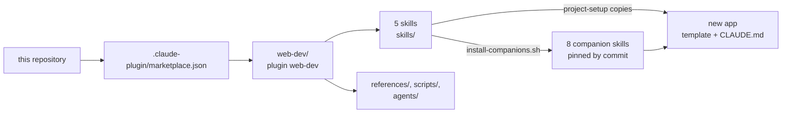
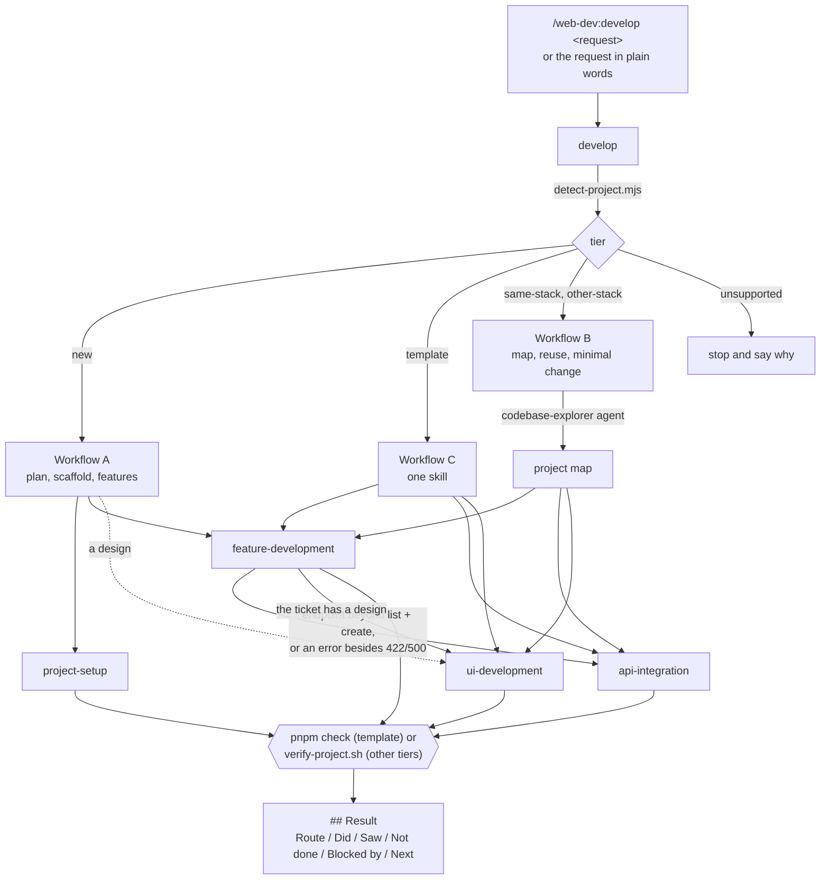
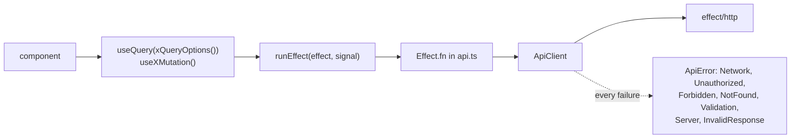

# Design

How the web-dev plugin is built and why. The requirements are in [`spec.md`](spec.md);
the user guide is [`web-dev/README.md`](web-dev/README.md).

## 1. Distribution

A developer adds the marketplace once and installs the plugin; the skills then load in every
project. The plugin is read in place from the clone, so `git pull` updates it. Copying
`skills/`, `references/`, `scripts/` and `agents/` into a project's `.claude/` works too: the
skills reach the shared files as `../../references/` and `../../scripts/`, which resolve in both
layouts.

## 2. One entry point, five skills

| Tier (`detect-project.mjs`) | The folder | Workflow |
|---|---|---|
| `new` | empty, or files without `package.json` (the app goes in a subfolder) | A: `docs/plan.md`, `project-setup`, `feature-development` per ticket, `ui-development` with a design; never asks |
| `template` | scaffolded from the template | C: the one skill the request needs (A for a whole app: no new scaffold) |
| `same-stack` | the same stack, another layout | B: `codebase-explorer` maps the roles, then the skill works through the project's own files |
| `other-stack` | React on another stack (axios, zod, another router) | B, as `same-stack`; a library the project lacks is a question, never added unasked |
| `unsupported` | not React, React behind an SSR framework (Next.js, Remix, Gatsby, Astro), a monorepo root | stop and report |

| Skill | Leads when | Hands off to |
|---|---|---|
| `develop` | Every request through the command, and a whole app described in plain words | The workflow's skills; one Result for A and B, the skill's own Result with a **Route** line for C |
| `project-setup` | A new project with no features described | — (tells the user about the other skills; skipped under Workflow A) |
| `feature-development` | A ticket, story or issue | `api-integration` for endpoint detail, `ui-development` for the UI when there is a design |
| `api-integration` | One endpoint on its own | — (when loaded by `feature-development`, it hands the UI and the Result back) |
| `ui-development` | A design with no ticket | — (when loaded by `feature-development`, it hands data work back) |

Each skill still triggers on its own words ("Implement this ticket", "Add PATCH /todos/:id"), so a
user who knows which one they need skips the routing. `develop` and `feature-development` tell
Claude to *invoke* the other skill with the Skill tool. A line that only says "details live in
`api-integration`" was treated as advice and skipped, so every handoff is an instruction.

## 3. The generated app

`project-setup/assets/app-template/` is a complete app; the skills teach Claude to extend it.

- One feature is one folder: `src/features/<name>/` with `schemas.ts`, `model.ts`, `api.ts`,
  `queries.ts`, `mocks.ts`, `routes.tsx`, `components/` and `__tests__/`. A feature registers in
  three files: `src/app/routes.tsx`, `src/mocks/handlers.ts` and the header in `root-layout.tsx`.
- Business rules are pure functions in `model.ts`, tested without rendering; a rule that needs
  today's date takes it as a parameter. Components and queries call them.
- Another feature is reached only through its `schemas`, `model`, `queries` or `routes`; lint
  (`no-restricted-imports`, a pattern for `src/features/**`) rejects its `api`, `mocks` and
  `components`.
- Shared markup lives once, in `src/components/`: `PageHeader`, `LoadingState`, `ErrorAlert` and
  `EmptyState`. A feature writes only what is its own (its list, its form); markup that a second
  feature needs moves there, with a test and a story.
- `ApiClient` is the only way to call the backend. It decodes every body with an Effect Schema
  and maps every failure to a typed `ApiError`, so a component can switch on
  `query.error._tag`.
- `runEffect` is the only bridge from Effect to TanStack Query; it passes the abort signal.
  Retries live in TanStack Query only (queries once, for network errors and 5xx answers).
- Forms use React Hook Form with `effectTsResolver(schema)` and
  shadcn `Field`; `setFormErrors` puts a 422's field errors under the right inputs.
- Tests run against MSW; an unhandled request fails the test. Every component has its own test
  file and story file; the page test covers only how the parts work together.

## 4. UI design

- shadcn/ui, style `radix-nova`, base color `neutral`, icons from `lucide-react`
  (`components.json`). Components in `src/components/ui/` come from the shadcn CLI and are
  never edited by hand.
- Colors, radius and font are CSS variables in `src/styles/index.css` (Tailwind 4,
  `@theme inline`); there is no `tailwind.config.js`. Code uses tokens such as `bg-background`
  and `text-muted-foreground`, never raw colors.
- Every data screen has four distinct states: loading (skeleton), error (alert with retry),
  empty (with the next action), success. Each component has a story per state, so
  `pnpm storybook` shows them all; the demo (`README.md`) shows them in the app.
- `ui-development` matches a design by changing token values in `:root`, so every component,
  focus ring and toast follows. It maps each design color by role, asks before adding a font
  dependency or restyling screens the design does not cover, and lists what the design leaves
  out under **Design gaps**. Its inputs are all optional: images, a Figma link (through Figma
  MCP), or a `DESIGN.md` whose written values win over measured ones. With none, it asks once,
  then keeps the current theme; under `develop` it never asks.

## 5. Decisions

| Decision | Why |
|---|---|
| Copy a pinned template instead of running `create vite` / `shadcn init` | Generators change output between versions and `shadcn init` is interactive. The template (lockfile included) starts green and identical every time. |
| Copy every snippet from the template or the worked feature | The stack is newer than most training data. Code written from memory typechecks in the model's head and fails in the project. |
| Exclude criteria that depend on an unanswered question | A plausible guess passes review and is wrong in production. The Result block names each exclusion and its question. |
| Pin companion skills to an audited commit | Third-party skills change without notice. Each was read in full for security and fit ([`companion-audit.md`](web-dev/docs/companion-audit.md)). |
| Rewrite the `shadcn` companion's `npx shadcn@latest` to `pnpm exec shadcn` | The upstream skill runs `shadcn@latest` automatically when it loads, which would run whatever npm serves at that moment. |
| `effectTsResolver` for forms (`@hookform/resolvers` 6) | It takes the Effect 4 Schema itself, so forms need no `Schema.toStandardSchemaV1` wrapper. `useForm` keeps explicit `<Input, unknown, Output>`: inferred from `defaultValues`, a literal union widens to `string` (the POC rebuild hit this). Version 5 supported Effect 3 only. |
| No `msw-storybook-addon`; stories start the app's own worker | Its 3.0.3 release calls MSW 2's `onUnhandledRequest`. |
| Route trees are factories (`createRoutes()`) | React Router mutates lazy route objects once loaded, so each router needs fresh ones. |
| Git hooks (husky) in the template and in this repository: lint-staged and typecheck before a commit, commitlint (Conventional Commits) on its message | Lint and type errors are stopped where they are written, not in CI or review, and the history stays readable. `.gitattributes` keeps files LF so Prettier passes on every OS. |
| CI runs `verify-template.sh` on every change to the plugin and on a schedule | A dependency release that breaks the template shows up before a user hits it. |
| Pin the `skills` CLI that installs the companions (`skills@1.7.2`), and install them on a CI schedule | A companion pinned by SHA but fetched by whatever installer npm serves today is only as safe as that release; a moved or deleted upstream path shows up in CI, not in a user's scaffold. |
| `pnpm lint` also runs `prettier --check`; skills run `pnpm lint:fix` before the gates | Generated code stays formatted without a sixth gate. Markdown is excluded: it is prose for Claude, and table padding is only diff noise. |
| `pnpm dev:mock` reads `.env.mock` (Vite mode `mock`) | `VITE_API_MOCKING=true pnpm dev` fails in PowerShell and cmd, and a fixed script is what the desktop app's `.claude/launch.json` can start for the visual check. |
| Lint rejects `fetch` in every form (`window.`, `globalThis.`, `self.`) and `XMLHttpRequest` | `no-restricted-globals` alone sees only a bare `fetch`, which left the "only through `ApiClient`" rule one prefix away from broken. |
| Arrow functions only, ES2015+ syntax enforced by lint (`func-style: expression`, `stylisticTypeChecked`, ...) | One style across the template, the quoted snippets and every feature the skills write later; a rule in lint holds where a rule in prose drifts. `function*` stays for `Effect.gen` / `Effect.fn`: JavaScript has no arrow generators. |
| The scaffold writes a narrow `.claude/settings.json` allow-list, only when the project has none | One message should run to the end: the POC sessions stalled on permission prompts. Only the pnpm commands the skills run are listed, not `pnpm *`, and an existing settings file is never touched. |
| One entry skill (`develop`) that routes, instead of a slash command plus five skills that compete on their descriptions | The plan asks for one input. A skill can be typed (`/web-dev:develop`) and still triggers on plain words; the routing rules live in one file instead of five descriptions. |
| Detect the project with a script (`detect-project.mjs`), not by reading files each time | The same folder always gets the same tier, the reasons are printed, and `check-detect.sh` tests it without a model. |
| Existing projects keep their stack; the skills say per rule what still holds outside the template | The template's layers are one way to meet the rules (typed errors, four states, tests on mocks). Forcing Effect or MSW into a working project is a rewrite nobody asked for. |
| Shared guidelines in `references/`, copied word for word into the template's `CLAUDE.md` | Skills need them in projects that never had the template; a scaffolded app needs them without the plugin. `check-guidelines.mjs` keeps the two copies equal. |
| The todos feature lives only in the skills' markdown, each block tagged `file=...`; `verify-template.sh` writes it into a scaffold and runs every gate | One source for what Claude copies. A separate fixture folder drifts from the markdown; untested markdown drifts from the libraries. |
