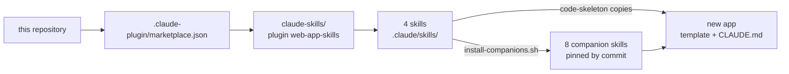
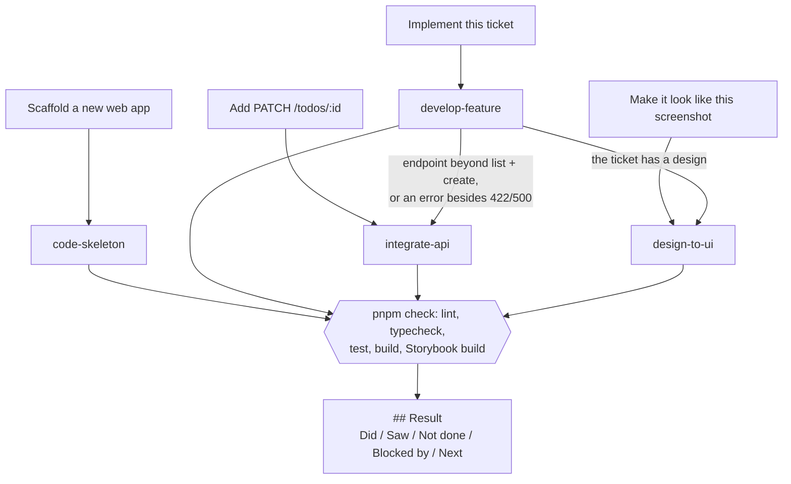
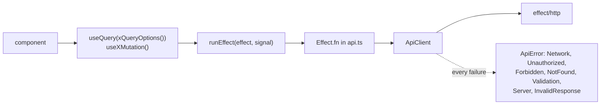

# Design

How the web-app-skills plugin is built and why. The requirements are in [`spec.md`](spec.md);
the user guide is [`claude-skills/README.md`](claude-skills/README.md).

## 1. Distribution

A developer adds the marketplace once and installs the plugin; the skills then load in every
project. The plugin is read in place from the clone, so `git pull` updates it. Copying the four
skill folders into a project's `.claude/skills/` works too.

## 2. The four skills and how they hand off

| Skill | Leads when | Hands off to |
|---|---|---|
| `code-skeleton` | A new project | — (tells the user about the other three) |
| `develop-feature` | A ticket, story or issue | `integrate-api` for endpoint detail, `design-to-ui` for the UI when there is a design |
| `integrate-api` | One endpoint on its own | — (when loaded by `develop-feature`, it hands the UI and the Result back) |
| `design-to-ui` | A design with no ticket | — (when loaded by `develop-feature`, it hands data work back) |

`develop-feature` tells Claude to *invoke* the other skill with the Skill tool. A line that only
says "details live in `integrate-api`" was treated as advice and skipped, so every handoff is an
instruction.

## 3. The generated app

`code-skeleton/template/` is a complete app; the skills teach Claude to extend it.

- One feature is one folder: `src/features/<name>/` with `schemas.ts`, `api.ts`, `queries.ts`,
  `mocks.ts`, `routes.tsx`, `components/` and `__tests__/`. A feature registers in three files:
  `src/app/routes.tsx`, `src/mocks/handlers.ts` and the header in `root-layout.tsx`.
- `ApiClient` is the only way to call the backend. It decodes every body with an Effect Schema
  and maps every failure to a typed `ApiError`, so a component can switch on
  `query.error._tag`.
- `runEffect` is the only bridge from Effect to TanStack Query; it passes the abort signal.
  Retries live in TanStack Query only (queries once, for network and server errors).
- Forms use React Hook Form with `standardSchemaResolver(Schema.toStandardSchemaV1(schema))` and
  shadcn `Field`; `setFormErrors` puts a 422's field errors under the right inputs.
- Tests run against MSW; an unhandled request fails the test. Every component has its own test
  file and story file; the page test covers only how the parts work together.

## 4. UI design

- shadcn/ui, style `radix-nova`, base color `neutral`, icons from `lucide-react`
  (`components.json`). Components in `src/components/ui/` come from the shadcn CLI and are
  never edited by hand.
- Colors, radius and font are CSS variables in `src/styles/index.css` (Tailwind 4,
  `@theme inline`); there is no `tailwind.config.js`. Code uses tokens such as `bg-background`
  and `text-muted-foreground`, never raw colors.
- Every data screen has four distinct states: loading (skeleton), error (alert with retry),
  empty (with the next action), success. Screenshots of each state, at desktop and mobile
  width, are in [`docs/evidence/`](docs/evidence/README.md).
- `design-to-ui` matches a design by changing token values in `:root`, so every component,
  focus ring and toast follows. It maps each design color by role, asks before adding a font
  dependency or restyling screens the design does not cover, and lists what the design leaves
  out under **Design gaps**.

## 5. Decisions

| Decision | Why |
|---|---|
| Copy a pinned template instead of running `create vite` / `shadcn init` | Generators change output between versions and `shadcn init` is interactive. The template (lockfile included) starts green and identical every time. |
| Copy every snippet from the template or the worked feature | The stack is newer than most training data. Code written from memory typechecks in the model's head and fails in the project. |
| Write version traps once, in the template's `CLAUDE.md` | One copy instead of one per skill, so a correction lands everywhere. The generated app keeps them for later sessions, even without the skills. |
| Exclude criteria that depend on an unanswered question | A plausible guess passes review and is wrong in production. The Result block names each exclusion and its question. |
| Pin companion skills to an audited commit | Third-party skills change without notice. Each was read in full for security and fit ([`companion-audit.md`](claude-skills/docs/companion-audit.md)). |
| Rewrite the `shadcn` companion's `npx shadcn@latest` to `pnpm exec shadcn` | The upstream skill runs `shadcn@latest` automatically when it loads, which would run whatever npm serves at that moment. |
| `standardSchemaResolver` for forms | `@hookform/resolvers`' `effectTsResolver` supports Effect 3 only. |
| No `msw-storybook-addon`; stories start the app's own worker | Its 3.0.3 release calls MSW 2's `onUnhandledRequest`. |
| Route trees are factories (`createRoutes()`) | React Router mutates lazy route objects once loaded, so each router needs fresh ones. |
| CI runs `verify.sh` on every change to the plugin and on a schedule | A dependency release that breaks the template shows up before a user hits it. |
| Pin the `skills` CLI that installs the companions (`skills@1.7.2`), and install them on a CI schedule | A companion pinned by SHA but fetched by whatever installer npm serves today is only as safe as that release; a moved or deleted upstream path shows up in CI, not in a user's scaffold. |
| `pnpm lint` also runs `prettier --check`; skills run `pnpm lint:fix` before the gates | Generated code stays formatted without a sixth gate. Markdown is excluded: it is prose for Claude, and table padding is only diff noise. |
| `pnpm dev:mock` reads `.env.mock` (Vite mode `mock`) | `VITE_API_MOCKING=true pnpm dev` fails in PowerShell and cmd, and a fixed script is what the desktop app's `.claude/launch.json` can start for the visual check. |
| Lint rejects `fetch` in every form (`window.`, `globalThis.`, `self.`) and `XMLHttpRequest` | `no-restricted-globals` alone sees only a bare `fetch`, which left the "only through `ApiClient`" rule one prefix away from broken. |
| Arrow functions only, ES2015+ syntax enforced by lint (`func-style: expression`, `stylisticTypeChecked`, ...) | One style across the template, the quoted snippets and every feature the skills write later; a rule in lint holds where a rule in prose drifts. `function*` stays for `Effect.gen` / `Effect.fn`: JavaScript has no arrow generators. |
