# web-dev-plugin

[](https://github.com/loiphan-agilityio/web-dev-plugin/actions/workflows/ci.yml)

Two Claude Code plugins for React web apps: **web-dev** builds tested code from one request,
**web-quality** measures what was built and fixes it.

| Plugin | What it does | Start with | Guide |
|---|---|---|---|
| **web-dev** | Scaffolds a project, builds features, endpoints and screens, sets up CI/CD, writes ticket, incident and PR contracts; every gate passes before it is done | `/web-dev:develop <request>` | [`web-dev/README.md`](web-dev/README.md) |
| **web-quality** | Audits speed, accessibility, SEO and security in a real browser, labels each finding measured or hypothesis, fixes it and measures again | `/web-quality:audit <url>` | [`web-quality/README.md`](web-quality/README.md) |

## Requirements

| For | You need |
|---|---|
| Both plugins | Claude Code and Node on your `PATH`: 22.22 or newer for web-dev, 22 or newer for web-quality |
| web-dev, always | pnpm 10 or newer, git, bash and tar; network access to github.com (the boilerplate, the companion skills) and to the npm registry (`pnpm install`, `npx skills`) |
| The e2e gate | Playwright's Chromium, downloaded once per machine by `pnpm test:e2e:install` |
| `pr`, `ticket` | `gh` (GitHub) or `glab` (GitLab), signed in; `ticket` only to read an issue by its number |
| `deploy-setup` | A GitHub repository and a Cloudflare account, reached with `gh` and `npx wrangler` when they are installed and signed in, else with Claude in Chrome signed in to both |
| `release` | `gh`, signed in, and a project whose CI/CD came from the boilerplate |
| web-quality | A browser tool that runs JavaScript in a page (Claude desktop's browser, Claude in Chrome or Chrome DevTools MCP); a deployed URL for the header checks; Playwright in the project for the accessibility test |

Tested on Linux only (CI runs on `ubuntu-latest`). The scripts are bash, so Windows needs WSL or
Git Bash; neither that nor macOS has been tested.

## Install

```bash
claude plugin marketplace add https://github.com/loiphan-agilityio/web-dev-plugin.git
claude plugin install web-dev@web-dev-plugin
claude plugin install web-quality@web-dev-plugin  # optional
```

With a GitHub SSH key, `git@github.com:loiphan-agilityio/web-dev-plugin.git` works as the source
too. A git install is a cached copy: a release reaches you when the plugin's `version` changes and
you run `claude plugin update web-dev@web-dev-plugin` (or `web-quality@web-dev-plugin`), then
restart Claude Code. Pinning a release and sharing the marketplace with a team:
[`web-dev/README.md`](web-dev/README.md#install).

## What installing web-dev changes

**A hook that is always on.** While the plugin is enabled, `web-dev/scripts/guard.mjs` runs before
every Bash, Read, Edit, MultiEdit, Write, NotebookEdit and Grep call Claude makes, in every folder,
not only in web-dev projects. It refuses history rewrites, discarding uncommitted work,
force-pushes, skipped git hooks, pushes to a protected branch, merging or approving a pull
request, production deploys, and reading or editing secret files (`.env*`, `.npmrc`, keys,
certificates). A refusal starts with `Blocked by the web-dev guardrails:`. The hook sees only
Claude's tool calls, so run the command yourself in your terminal. There is no switch per rule: to
turn the hook off, disable or uninstall the plugin. Details:
[`web-dev/README.md`](web-dev/README.md#guardrails-hook).

**Third-party skills in each new project.** `project-setup` runs `install-companions.sh` without
asking: `npx skills@1.7.2` fetches eight third-party skills, each pinned to an audited commit,
into the project's `.claude/skills/`. A failed install is reported and the setup goes on. Which
skills and why: [`web-dev/README.md`](web-dev/README.md#companion-skills); the audit:
[`web-dev/docs/companion-audit.md`](web-dev/docs/companion-audit.md).

web-quality adds no hook; its scripts are read-only.

## First run

In any empty folder:

```bash
mkdir library-manager && cd library-manager
claude "/web-dev:develop Build me a library management app. Librarians manage the book catalogue and the members, lend books to members and record returns, and need to see which loans are overdue."
```

It stops once, before anything is created, for the git questions: the name and email the commits
carry, a GitHub or GitLab repository URL or local git only, and whether to push the scaffold to
`main` now or later. Then it writes `docs/plan.md`, creates the project from the boilerplate
(`git init -b main`, `pnpm install`, the companion skills, Playwright's Chromium), builds each
planned feature with its API layer, mocks, tests and stories, runs the six gates and ends with a
`## Result` block. Nothing is pushed without your yes. Run the app on its mocked API with
`pnpm dev:mock` and sign in as `demo@example.com` / `password`.

A request with no features (`claude "Scaffold a new web app called billing-portal"`) builds only
the project, and also asks whether it is a landing page or a web app when the request does not say.

For later work, start Claude in the app, not at the project root, where `develop` reports a
monorepo root and stops:

```bash
cd apps/web && claude --add-dir ../..
```

## How it works

<picture>
  <source media="(prefers-color-scheme: dark)" srcset="docs/workflow-map/overview-dark.svg">
  
</picture>

## Repository

| Path | Contents |
|---|---|
| [`web-dev/`](web-dev/), [`web-quality/`](web-quality/) | The two plugins |
| [`.claude-plugin/marketplace.json`](.claude-plugin/marketplace.json) | The marketplace that lists them |
| [`docs/workflow-map/`](docs/workflow-map/) | The two diagrams the READMEs show |
| [`spec.md`](spec.md), [`DESIGN.md`](DESIGN.md), [`CLAUDE.md`](CLAUDE.md) | Requirements, design, rules for changing the repository |
| [`tools/`](tools/), [`.github/workflows/`](.github/workflows/) | Maintainer scripts and CI |

## License

MIT: [`LICENSE`](LICENSE).

## Contributing

Rules: [`CLAUDE.md`](CLAUDE.md). Steps and checks:
[`web-dev/README.md`](web-dev/README.md#contributing).
