# web-dev-plugin

[](https://github.com/loiphan-agilityio/web-dev-plugin/actions/workflows/ci.yml)
[](https://nodejs.org)
[](https://pnpm.io)
[](https://docs.claude.com/en/docs/claude-code/overview)

[](https://react.dev)
[](https://vite.dev)
[](https://www.typescriptlang.org)
[](https://effect.website)
[](https://tanstack.com/query)
[](https://react-hook-form.com)
[](https://ui.shadcn.com)
[](https://reactrouter.com)

[](https://vitest.dev)
[](https://mswjs.io)
[](https://playwright.dev)
[](https://storybook.js.org)
[](https://docs.github.com/actions)
[](https://pages.cloudflare.com)

Claude Code plugins for React web apps. **web-dev** builds tested code from one request, on the
stack above, and runs every gate before it calls the work done. **web-quality** audits what was
built.

| Plugin | Start with | Skills | Guide |
|---|---|---|---|
| web-dev | `/web-dev:develop <request>` | `project-setup`, `feature-development`, `api-integration`, `ui-development`, `deploy-setup`, and the contract skills `ticket`, `incident`, `pr` | [`web-dev/README.md`](web-dev/README.md) |
| web-quality | `/web-quality:audit <url or project>` | `performance`, `accessibility`, `seo`, `security` | [`web-quality/README.md`](web-quality/README.md) |

## Install

Requirements: Node 22.22 or newer, pnpm 10 or newer, Claude Code.

```bash
claude plugin marketplace add git@github.com:loiphan-agilityio/web-dev-plugin.git
claude plugin install web-dev@web-dev-plugin
claude plugin install web-quality@web-dev-plugin  # optional
```

Updates, pinning a release and headless runs:
[`web-dev/README.md`](web-dev/README.md#install).

## Demo

In an empty folder, one message builds a whole app:

```bash
mkdir -p examples/library-manager && cd examples/library-manager
claude "/web-dev:develop Build me a library management app. Librarians manage the book catalogue and the members, lend books to members and record returns, and need to see which loans are overdue."
```

It writes `docs/plan.md` (data model, API, tickets, assumptions), builds every planned page with
its API layer, mocks, tests and stories, passes all six gates, and opens the app on a mocked API
or tells you to run `pnpm dev:mock`. `examples/` and `docs/evidence/` are git-ignored.

## Audit with web-quality

`/web-quality:audit` measures a page in a real browser and its build: Core Web Vitals, bundle size
against budgets, response headers, accessibility (WCAG 2.2 AA), SEO, dependency advisories and,
for a public URL, PageSpeed Insights. Each finding is labelled measured, config or hypothesis,
judged against [`thresholds.md`](web-quality/references/thresholds.md), and handed to the skill
that fixes it, which measures again.

```bash
claude "/web-quality:audit https://app.example.com"
```

| Skill | Fixes |
|---|---|
| `performance` | LCP, INP and CLS, and the initial load against its budget |
| `accessibility` | WCAG 2.2 AA with axe, keyboard and accessibility-tree checks, plus a regression test |
| `seo` | Titles, descriptions, canonical URLs, robots, sitemap and social cards |
| `security` | Security headers and CSP, vulnerable dependencies, XSS and other frontend risks |

It needs a browser tool that runs JavaScript in the page (the Claude desktop app, Claude in
Chrome, or Chrome DevTools MCP). See [`web-quality/README.md`](web-quality/README.md).

## Workflow map

How web-dev turns one request into a deployed app. Every view of the
[interactive map](https://claude.ai/artifact/1Bkd5BEPCooVzMddsjqgcx#map) (claude.ai, for members of
the organization) is below; a card marked ⤢ has its own view.

<details open>
<summary><b>Overview</b></summary>

develop routes every request (its inner view shows which skill each case gets): it scaffolds, then builds each ticket, and ticket and incident write their contracts first. Build skills end on pnpm check, pr opens the pull request, and the boilerplate's CI/CD deploys it.

<picture>
  <source media="(prefers-color-scheme: dark)" srcset="docs/workflow-map/overview-dark.svg">
  
</picture>

| Card | What | When | How |
|---|---|---|---|
| [**/web-dev:develop**](web-dev/skills/develop/SKILL.md)<br>skill · the one entry point | Sorts the folder and the request, then runs the workflow or skill that fits: a whole app, a change in an existing project, one change in an app from the boilerplate, or a ticket, incident or PR contract. | Every request typed as /web-dev:develop &lt;request&gt;, and a whole app or landing page described in plain words. | Runs `detect-project.mjs` for the tier, sorts the request (app, setup, landing, ticket contract, incident, pr, feature, api, ui, ci), then Workflow A (new app), B (existing project), C (one skill) or the contract skill. Never asks under A: every gap gets a default in `docs/plan.md`. |
| [**project-setup**](web-dev/skills/project-setup/SKILL.md)<br>skill · boilerplate + gates | Creates the project from the react-vite-boilerplate at the pinned commit: a landing page, or a web app, which always has authentication. Installs it, adds the companion skills and runs every gate. | "Scaffold a new web app", a landing page in an empty folder, or step A2 of develop's Workflow A. | Asks one question, landing page or web app (never picks for you). Then `create-project.sh`, `pnpm install`, `install-companions.sh`, `pnpm test:e2e:install` and `pnpm check:report`. After `git init`, `pnpm run prepare` turns the git hooks on. |
| [**feature-development**](web-dev/skills/feature-development/SKILL.md)<br>skill · ticket to tested feature | Turns one ticket into a feature folder: schemas, rules, API, queries, form, four UI states, routes, unit tests, stories and one Playwright spec. | "Implement this ticket", a ticket contract in `docs/tickets/<id>/`, or each ticket of Workflow A, one subagent per ticket. | Copies the shapes of the verified todos feature; hands endpoints beyond list + create to api-integration and a design to ui-development. With a contract, builds in its `T<n>` order and ticks each `AC-<n>`. Ends on `pnpm -w check:report`. |
| [**api-integration**](web-dev/skills/api-integration/SKILL.md)<br>skill · one endpoint end to end | Adds or changes one endpoint: Effect Schema, an Effect.fn through ApiClient, a query or mutation, MSW mocks and error tests. | "Add PATCH /todos/:id", or loaded by feature-development for any endpoint beyond list + create. | Every failure maps to one of 7 typed ApiError cases; mutations invalidate exactly the keys they change; then `pnpm check`. |
| [**ui-development**](web-dev/skills/ui-development/SKILL.md)<br>skill · design to matching UI | Matches a design (screenshot, Figma, DESIGN.md) with theme tokens and shadcn components, keeping all four data states. | "Make it look like this screenshot", or a ticket that carries a design. | Maps colours by role into `:root` tokens, builds the regions, tests by role, compares in a browser up to 3 rounds, then `pnpm check`. |
| [**incident**](web-dev/skills/incident/SKILL.md)<br>skill · report · rca · actions | Writes a blameless incident record: `docs/incidents/<id>/report.md`, `rca.md` and `actions.md`. | /web-dev:incident INC-12, a postmortem or a root cause analysis. | Labels each claim measured or hypothesis; follow-ups `A<n>` get an owner. Then `check-contract.mjs` and a commit on a branch. Follow-ups can become ticket contracts. |
| [**ticket**](web-dev/skills/ticket/SKILL.md)<br>skill · intent · spec · plan | Writes the contract for one ticket or several: `docs/tickets/<id>/intent.md`, `spec.md` and `plan.md`, grounded in the project's code. | /web-dev:ticket 412 413, or "write the contract for issue #412". | Reads the issue (gh or glab) or the pasted text. Criteria as `AC-<n>`, tasks as `T<n>` that cite them; several tickets run in parallel, one subagent each. Then `check-contract.mjs` and a commit on a `docs/` branch. |
| [**pnpm check**](https://github.com/loiphan-agilityio/react-vite-boilerplate/blob/main/package.json)<br>board · six gates before done | Lint (Oxlint, anti-slop, Prettier), typecheck, unit tests with 80% line coverage, build, Storybook build, Playwright e2e. | The last step of every build skill; in CI, gates 1–5 run before the deploy and e2e after production. | Two turbo runs from the monorepo root. `pnpm check:report` runs the same gates, goes on after a failure and prints the checklist. In a project not made from the boilerplate, `verify-project.sh` runs the gates it has and names the ones it lacks. |
| [**pr**](web-dev/skills/pr/SKILL.md)<br>skill · draft, ready after CI | Opens a pull request (gh) or merge request (glab) for the current branch, described by its contract: Why, Changes, Ticket, Evidence. | /web-dev:pr, or "open a PR for ticket 412". | Stops on a protected branch, uncommitted changes or a failing gate. Runs `pnpm check:report` for the evidence, checks the description with `check-contract.mjs`, pushes, opens a draft and marks it ready only when CI passes. Never merges. |
| [**GitHub Actions**](https://github.com/loiphan-agilityio/react-vite-boilerplate/blob/main/.github/workflows/ci.yml)<br>board · CI/CD from the boilerplate | check, a Cloudflare Pages preview of the app and Storybook, Lighthouse on it, production on main, then e2e on production. | Every pull request and push to main once the project is on GitHub. | `.github/workflows/ci.yml` comes with the boilerplate; `deploy-setup` connects it. Deploys need the CLOUDFLARE_API_TOKEN secret, CLOUDFLARE_ACCOUNT_ID and CLOUDFLARE_PAGES_APP_PROJECT; without the project variable the deploy jobs are skipped. |
| [**deploy-setup**](web-dev/skills/deploy-setup/SKILL.md)<br>skill · CI/CD + Cloudflare Pages | Brings the boilerplate's pipeline into a project from it, at the pinned commit, then connects Cloudflare Pages and GitHub. | "Set up CI/CD", "deploy to Cloudflare Pages", "move from Netlify", or a ci request in a template or landing project. | `sync-pipeline.mjs` copies the workflow, ruleset, Playwright and Allure configs and `_headers` from a reference project of the same kind; then every gate; then, asking before each command, the Pages projects, the GitHub variables and ruleset. You set the API token secret. |

</details>

<details open>
<summary><b>/web-dev:develop</b></summary>

The tier and the kind of request pick the route: A builds a whole app, an empty folder gets project-setup, C and the landing route run one skill, B maps the project first, contract requests go to their own skill, and the rest stops or is not covered yet. Double-click a route to see the skills it runs.

<picture>
  <source media="(prefers-color-scheme: dark)" srcset="docs/workflow-map/develop-dark.svg">
  
</picture>

| Card | What | When | How |
|---|---|---|---|
| [**detect-project.mjs**](web-dev/scripts/detect-project.mjs)<br>script · tier + reasons | Sorts the folder: new, template, landing, same-stack, other-stack or unsupported. | First step of develop. | Reads package.json, lockfiles and markers; prints JSON with the tier and its reasons. Same folder, same tier. |
| [**Contracts**](web-dev/skills/develop/SKILL.md)<br>route · ticket · incident · pr | A ticket contract, an incident record or a pull request. | Any tier but unsupported. | develop invokes ticket, incident or pr; that skill's Result, with the Route line on top, is the report. |
| [**Setup or landing**](web-dev/skills/develop/SKILL.md)<br>route · an empty folder | A new project with no features, or a landing page, in an empty folder. | Tier new with nothing in the folder, and a setup or landing request. | setup: `project-setup`, which asks landing page or web app and never picks for you. landing: `project-setup` with `--landing` (no question), then `ui-development` fits the page's copy and sections to the description and design; one Result. |
| [**Workflow A**](web-dev/skills/develop/references/new-app.md)<br>route · a whole app, never asks | A new app from one description. | Tier new (or template, for a whole app). | Writes `docs/plan.md` (data model, API, 2–5 tickets, mock data, assumptions), runs project-setup as a web app (A2, skipped in a template folder), builds each ticket with feature-development in its own subagent (A3), applies a design once with ui-development (A4), runs the gates and opens the app on mocks. |
| [**Workflow C**](web-dev/skills/develop/SKILL.md)<br>route · one skill | One feature, endpoint or screen in a template app. | Tier template. | Invokes the one skill the request needs and follows it through its gates and Result, with a Route line on top. |
| [**Landing page**](web-dev/skills/develop/SKILL.md)<br>route · UI and deploy only | A landing page from the boilerplate: its UI kit, no API layer or Effect. | Tier landing. | A landing or ui request goes to `ui-development`, a ci request to `deploy-setup`; anything that needs data goes to Workflow B, which asks before adding a library. |
| [**Workflow B**](web-dev/skills/develop/references/existing-project.md)<br>route · existing React project | A change in a project not made from the template. | Tier same-stack or other-stack; a landing project for anything that needs data. | One change (B1): the codebase-explorer agent maps the roles, then the skill for the kind (feature-development, api-integration or ui-development) builds it on the project's own client, query layer and tests, adds no library unasked, then `verify-project.sh`. A whole app (B2): a plan as in Workflow A, then each ticket through B1. A setup request in a folder with files (B3): a template or landing project gets only the missing piece, another stack gets nothing and the offer of a new project in a subfolder, and a folder of other files gets project-setup in a new subfolder. |
| [**Stops**](web-dev/skills/develop/SKILL.md)<br>route · unsupported: says why | Not React, React behind an SSR framework (Next.js, Remix, Gatsby, Astro), or a monorepo root: nothing changes. | Tier unsupported. | Reports detect's `reasons`. A ci request at a monorepo root with `apps/web` is detected again in `apps/web` and routed by that tier, since the pipeline lives at the root. |
| [**Not yet**](web-dev/skills/develop/SKILL.md)<br>route · says so, changes nothing | A bug fix, a review with no edits, a commit or push on its own, or CI/CD in a project not made from the boilerplate. | Any tier. | The Result says this version does not cover it, and nothing changes. The contract commit of `ticket` and `incident` and the push `pr` makes are covered. |

Also in this view, with their details in an earlier view: **/web-dev:develop** (web-dev).

</details>

<details>
<summary><b>/web-dev:develop › Workflow A</b></summary>

One description, one plan, then the scaffold, every ticket in its own subagent, an optional design pass, the gates, and the app open on mocks. It never asks.

<picture>
  <source media="(prefers-color-scheme: dark)" srcset="docs/workflow-map/wf-a-dark.svg">
  
</picture>

| Card | What | When | How |
|---|---|---|---|
| [**Run it**](web-dev/skills/develop/references/new-app.md)<br>step · pnpm dev:mock | Opens the app on the mocked API. | Workflow A, step A6. | With the desktop browser tools, a `dev-mock` entry in `.claude/launch.json` and a preview; otherwise no server is left running and the Result says to run `pnpm dev:mock`. Sign in as demo@example.com / password. |

Also in this view, with their details in an earlier view: **Workflow A** (/web-dev:develop), **project-setup** (web-dev), **feature-development** (web-dev), **ui-development** (web-dev), **pnpm check** (web-dev).

</details>

<details>
<summary><b>/web-dev:develop › Setup or landing in an empty folder</b></summary>

A setup request gets project-setup, which asks the kind; a landing request gets the landing variant, then ui-development fits its copy and sections.

<picture>
  <source media="(prefers-color-scheme: dark)" srcset="docs/workflow-map/wf-empty-dark.svg">
  
</picture>

Also in this view, with their details in an earlier view: **Setup or landing** (/web-dev:develop), **project-setup** (web-dev), **ui-development** (web-dev).

</details>

<details>
<summary><b>/web-dev:develop › Workflow C</b></summary>

One change in an app from the boilerplate: the one skill the request needs, through its gates and Result, with the Route line on top.

<picture>
  <source media="(prefers-color-scheme: dark)" srcset="docs/workflow-map/wf-c-dark.svg">
  
</picture>

Also in this view, with their details in an earlier view: **Workflow C** (/web-dev:develop), **feature-development** (web-dev), **api-integration** (web-dev), **ui-development** (web-dev), **deploy-setup** (web-dev).

</details>

<details>
<summary><b>/web-dev:develop › Landing page</b></summary>

A landing page from the boilerplate: UI and deploy only; anything that needs data goes to Workflow B, which asks before adding a library.

<picture>
  <source media="(prefers-color-scheme: dark)" srcset="docs/workflow-map/wf-landing-dark.svg">
  
</picture>

Also in this view, with their details in an earlier view: **Landing page** (/web-dev:develop), **ui-development** (web-dev), **deploy-setup** (web-dev), **Workflow B** (/web-dev:develop).

</details>

<details>
<summary><b>/web-dev:develop › Workflow B</b></summary>

The project's own architecture wins: map it, build with the skill for the kind on its code, then run its own gates.

<picture>
  <source media="(prefers-color-scheme: dark)" srcset="docs/workflow-map/wf-b-dark.svg">
  
</picture>

| Card | What | When | How |
|---|---|---|---|
| [**codebase-explorer**](web-dev/agents/codebase-explorer.md)<br>route · read-only agent | Maps an existing project before it is changed. | Workflow B, step 1. | Returns the file for each role (HTTP client, query layer, forms, routing, UI kit, tests, mocks), the conventions and the gate commands. |
| [**verify-project.sh**](web-dev/scripts/verify-project.sh)<br>script · the project's own gates | Runs the gates a project has, with its own package manager. | Workflow B regression checks. | Every gate runs even after one fails; it names the gates the project lacks. A template app runs `pnpm check`. |

Also in this view, with their details in an earlier view: **Workflow B** (/web-dev:develop), **feature-development** (web-dev), **api-integration** (web-dev), **ui-development** (web-dev).

</details>

<details>
<summary><b>/web-dev:develop › Contracts</b></summary>

A ticket contract, an incident record or a pull request: develop runs that skill, and its Result, with the Route line on top, is the report.

<picture>
  <source media="(prefers-color-scheme: dark)" srcset="docs/workflow-map/wf-docs-dark.svg">
  
</picture>

Also in this view, with their details in an earlier view: **Contracts** (/web-dev:develop), **ticket** (web-dev), **incident** (web-dev), **pr** (web-dev).

</details>

<details>
<summary><b>project-setup</b></summary>

Create from the boilerplate, install, companions, gates: the project starts green, and the git hooks turn on after git init.

<picture>
  <source media="(prefers-color-scheme: dark)" srcset="docs/workflow-map/project-setup-dark.svg">
  
</picture>

| Card | What | When | How |
|---|---|---|---|
| [**create-project.sh**](web-dev/skills/project-setup/scripts/create-project.sh)<br>script · boilerplate at ace5470 | Fetches the react-vite-boilerplate at the commit this plugin version pins and runs the boilerplate's own generator. | project-setup step 3. | `--auth` (a web app) or `--landing`; `--no-auth` is refused. Copies the result into the target, keeping `.git/` and `.claude/`; copies nothing when a project file already exists or the fetch fails. |
| [**pnpm install**](https://github.com/loiphan-agilityio/react-vite-boilerplate/blob/main/apps/web/package.json)<br>script · workspace + msw init | Installs every workspace package from the lockfile. | project-setup step 4. | In a web app, the app's postinstall runs `msw init`, which writes `apps/web/public/mockServiceWorker.js`; a landing page has no MSW. Then `pnpm test:e2e:install` downloads Chromium once per machine. |
| [**install-companions.sh**](web-dev/skills/project-setup/scripts/install-companions.sh)<br>script · 8 pinned skills | Installs 8 audited third-party skills, pinned by commit. | project-setup step 5. | Uses the pinned skills CLI; fails on a missing companion, a missing skills-lock.json or an unpinned shadcn@latest. |
| [**git hooks**](https://github.com/loiphan-agilityio/react-vite-boilerplate/blob/main/.husky/pre-push)<br>hook · pnpm run prepare | Husky hooks from the boilerplate: pre-commit (lint-staged, typecheck), commit-msg (commitlint) and pre-push, which refuses main, master, dev, stag, prod and their long names. | After `git init`, when you say yes to it. | `pnpm run prepare` turns them on; project-setup checks that `.husky/_/pre-push` exists before saying the hooks are on. |

Also in this view, with their details in an earlier view: **project-setup** (web-dev), **pnpm check** (web-dev).

</details>

<details>
<summary><b>project-setup › install-companions.sh</b></summary>

Eight third-party skills, audited and pinned by commit; references/companions.md lists what each gets wrong for this stack.

<picture>
  <source media="(prefers-color-scheme: dark)" srcset="docs/workflow-map/companions-dark.svg">
  
</picture>

| Card | What | When | How |
|---|---|---|---|
| [**shadcn**](web-dev/references/companions.md)<br>companion skill | Adds shadcn components with the CLI. | A missing UI primitive. | Rewritten to `pnpm exec shadcn` so nothing runs @latest. |
| [**react-router-data-mode**](web-dev/references/companions.md)<br>companion skill | React Router data-mode patterns. | Routes and navigation. | Ignore loader-first fetching; data goes through TanStack Query. |
| [**vite + vitest**](web-dev/references/companions.md)<br>companion skill | Vite config and Vitest usage. | Build or test config. | No Jest APIs; MSW for every request. |
| [**react best practices**](web-dev/references/companions.md)<br>companion skill | React performance and composition patterns. | Component design. | Ignore its Next.js / RSC advice. |
| [**react-hook-form**](web-dev/references/companions.md)<br>companion skill | React Hook Form patterns. | Forms. | Use effectTsResolver, never zodResolver. |
| [**react-testing**](web-dev/references/companions.md)<br>companion skill | React Testing Library patterns. | Unit tests. | Query by role and label; Vitest, not Jest. |

Also in this view, with their details in an earlier view: **install-companions.sh** (project-setup).

</details>

<details>
<summary><b>feature-development</b></summary>

One ticket becomes one feature folder; endpoints and designs go to the other two skills.

<picture>
  <source media="(prefers-color-scheme: dark)" srcset="docs/workflow-map/feature-development-dark.svg">
  
</picture>

| Card | What | When | How |
|---|---|---|---|
| **Understand the ticket**<br>step · criteria, gaps sorted | Lists the acceptance criteria and sorts every gap; a `docs/tickets/<id>/` contract is the ticket when there is one. | feature-development, in order. | An open question (data, rule, contract) excludes its criterion and is asked; a presentation detail gets the simplest default, listed under Next. A contract's `AC-<n>` are the criteria, its `T<n>` the build order. |
| **Data layer**<br>step · schemas, model, api, queries | Effect Schemas, business rules as pure functions, Effect.fn calls through ApiClient, a key factory and queryOptions. | feature-development, in order. | Copied from the verified todos feature; anything beyond one list and one create goes to api-integration. |
| **Form + four states**<br>step · RHF + shadcn Field | The form with effectTsResolver and server 422 errors under their fields; loading, error with retry, empty and success. | feature-development, in order. | With a design, ui-development leads the UI. |
| **Routes + wiring**<br>step · lazy route, mocks, nav | A lazy route factory registered in routes.tsx (inside protectedRoutes in an app with authentication), the mock handlers in handlers.ts and a nav link when the layout has one. | feature-development, in order. | Three files, the diff quoted in feature-layout.md. |
| **Tests, stories, e2e**<br>step · unit + story per component | A unit test and a story per component, a page test, schema and model tests, and one Playwright spec e2e/&lt;name&gt;.spec.ts. | feature-development, in order. | Unit tests drive every state with MSW; the e2e spec walks the main flow from the header link on the mock build. |

Also in this view, with their details in an earlier view: **pnpm check** (web-dev), **api-integration** (web-dev), **ui-development** (web-dev).

</details>

<details>
<summary><b>ticket</b></summary>

Contracts before code: one subagent per ticket, checked, committed on a branch for review; feature-development builds from the folder.

<picture>
  <source media="(prefers-color-scheme: dark)" srcset="docs/workflow-map/ticket-dark.svg">
  
</picture>

| Card | What | When | How |
|---|---|---|---|
| **Collect the tickets**<br>step · issue or pasted text | An id and the text for each ticket. | ticket, step 1. | `gh issue view <n> --comments` or `glab issue view`, or a key from another tracker with the text pasted. Text with no id gets a question, never an invented number. |
| **Write each contract**<br>step · one subagent per ticket | intent.md (the problem, no solution), spec.md (`AC-<n>` as given / when / then, open questions) and plan.md (`T<n>` tasks in build order, real file paths, the gates). | ticket, step 2. | Reads the project's CLAUDE.md and the code the ticket touches. Two or more tickets: one subagent each, at most five at a time, each writing only its own folder. |
| [**check-contract.mjs**](web-dev/scripts/check-contract.mjs)<br>script · contract shape | Checks a ticket or incident folder, or a PR description, against the shape its skill writes. | The last step of ticket and incident; pr runs it before opening; feature-development runs it after building from a contract. | Prints JSON with each check; exits 1 on a missing file or section, a `<!-- fill` marker left, a criterion no task cites, or a failing gate in the evidence. |
| **Commit on a branch**<br>step · docs/ticket-&lt;id&gt; | The contract goes through review like code. | ticket, step 4. | `git switch -c docs/ticket-<id>`, add only the contract folders, commit `docs(ticket): …`. Push and the PR only when asked; each git command asks first. |

Also in this view, with their details in an earlier view: **feature-development** (web-dev).

</details>

<details>
<summary><b>incident</b></summary>

A blameless record from measured facts; its follow-ups can become ticket contracts.

<picture>
  <source media="(prefers-color-scheme: dark)" srcset="docs/workflow-map/incident-dark.svg">
  
</picture>

| Card | What | When | How |
|---|---|---|---|
| **Gather the facts**<br>step · logs, alerts, commits, CI | Alerts, logs, the change that shipped and the CI run, each quoted with its source. | incident, step 1. | `git log --since`, the suspect diff, `gh run view`. Asks once for when it started, the impact and whether it is still happening; a fact nobody has is written `unknown`. |
| **Write the record**<br>step · measured or hypothesis | report.md (UTC times, measured impact, Status open, mitigated or resolved), rca.md (root cause and trigger) and actions.md (the fix, follow-ups `A<n>` with an owner). | incident, step 2. | Blameless: it names changes, gates and alerts, never people. It prefers a test, a type, a lint rule or a gate over "be careful". |
| **Commit on a branch**<br>step · docs/incident-&lt;id&gt; | The record goes through review like code. | incident, step 4. | `git switch -c docs/incident-<id>`, commit `docs(incident): …`. Push and the PR only when asked. |

Also in this view, with their details in an earlier view: **check-contract.mjs** (ticket), **ticket** (web-dev).

</details>

<details>
<summary><b>pr</b></summary>

The branch's pull request, with the checklist as evidence; a draft until CI passes, never merged by the skill.

<picture>
  <source media="(prefers-color-scheme: dark)" srcset="docs/workflow-map/pr-dark.svg">
  
</picture>

| Card | What | When | How |
|---|---|---|---|
| **Preconditions**<br>step · branch, tree, gh / glab | Stops when the branch is protected, the work tree has uncommitted changes, or gh / glab is not signed in. | pr, step 1. | Protected: main, master, dev, develop, stag, staging, prod, production, the same list as the boilerplate's pre-push hook. The base is the branch you name, else the remote's default. |
| [**pnpm check:report**](https://github.com/loiphan-agilityio/react-vite-boilerplate/blob/main/tools/check-report.mjs)<br>script · the checklist | Runs the six gates one after another, keeps going after a failure, then prints a checklist: each gate, the unit and e2e pass rates, line coverage and times. | project-setup, feature-development and pr put its table in their Result or description; CI writes it to the run summary. | `node tools/check-report.mjs`; `--only` and `--skip` pick gates. Exits 1 when a gate fails. |
| **Write the description**<br>step · outside the repository | Why (from intent.md), Changes (from the diff), Ticket (the contract link and the criteria it covers, or `none: <why>`), Evidence (the checklist, then `CI: pending`). | pr, step 4. | Written to `pr-body.md` in a `mktemp -d` folder, so it is never committed. The title is a Conventional Commit. |
| **Open a draft**<br>step · push, then --draft | Pushes the branch and opens the PR or MR as a draft. | pr, step 5. | `git push -u origin <branch>` (never --no-verify or --force), then `gh pr create --draft` or `glab mr create --draft`; an open one gets its description updated instead. |
| **Ready after CI**<br>step · never merges | Marks the PR ready for review once every check passes. | pr, step 5, after CI. | Waits for CI in the background. All green: the run's link replaces `CI: pending`, then `gh pr ready`. A failing or missing CI leaves the draft as it is. Never merges or approves. |

Also in this view, with their details in an earlier view: **check-contract.mjs** (ticket).

</details>

<details>
<summary><b>pnpm check</b></summary>

Six gates in order; check:report runs them all and prints the checklist; test:watch re-runs the unit tests on every save while you code.

<picture>
  <source media="(prefers-color-scheme: dark)" srcset="docs/workflow-map/gates-dark.svg">
  
</picture>

| Card | What | When | How |
|---|---|---|---|
| [**test:watch**](https://github.com/loiphan-agilityio/react-vite-boilerplate/blob/main/apps/web/package.json)<br>hook · re-runs on every save | Vitest in watch mode. | While writing code, in a terminal of its own. | `vitest --watch` re-runs the tests that import a saved file; --watch keeps it watching even when CI is set. |
| [**lint**](https://github.com/loiphan-agilityio/react-vite-boilerplate/blob/main/oxlint.config.ts)<br>step · Oxlint, anti-slop, Prettier | Oxlint with --type-aware --deny-warnings (the only linter) and prettier --check. | Gate 1. | Rejects fetch, axios, zod, react-router-dom and another feature's api, mocks and components; anti-slop rejects habits of generated code such as comparing `_tag` by hand. |
| [**typecheck**](https://github.com/loiphan-agilityio/react-vite-boilerplate/blob/main/apps/web/tsconfig.json)<br>step · tsc -b | TypeScript 6 strict build mode. | Gate 2. | tsconfig.app.json for src, tsconfig.node.json for configs and e2e/. |
| [**test**](https://github.com/loiphan-agilityio/react-vite-boilerplate/blob/main/apps/web/vite.config.ts)<br>step · Vitest + MSW, 80% lines | Unit and component tests once, with coverage. | Gate 3. | MSW fails any unhandled request; coverage below 80% lines in src/features and src/lib fails. |
| [**build**](https://github.com/loiphan-agilityio/react-vite-boilerplate/blob/main/apps/web/package.json)<br>step · tsc + vite build | Production build. | Gate 4. | `build:mock` is the same build with MSW on; e2e builds it into `dist-e2e/`, and CI deploys that build. |
| [**build-storybook**](https://github.com/loiphan-agilityio/react-vite-boilerplate/blob/main/apps/web/.storybook/main.ts)<br>step · every story compiles | Static Storybook build. | Gate 5. | One story per state per component, mocks through parameters.msw.handlers. |
| [**test:e2e**](https://github.com/loiphan-agilityio/react-vite-boilerplate/blob/main/apps/web/playwright.config.ts)<br>step · Playwright on mock build | Playwright specs in e2e/ on Chromium. | Gate 6, and again in CI against the deploy. | Builds with `pnpm build:mock` into `dist-e2e/` and serves it with `vite preview` on port 4173; with E2E_BASE_URL set it tests that URL instead. Writes an Allure report (`pnpm --filter web test:e2e:report`). |

Also in this view, with their details in an earlier view: **pnpm check:report** (pr).

</details>

<details>
<summary><b>GitHub Actions + Cloudflare Pages</b></summary>

A Pages preview with Lighthouse, then production on main, then the one e2e run on production.

<picture>
  <source media="(prefers-color-scheme: dark)" srcset="docs/workflow-map/ci-cd-dark.svg">
  
</picture>

| Card | What | When | How |
|---|---|---|---|
| [**check job**](https://github.com/loiphan-agilityio/react-vite-boilerplate/blob/main/.github/workflows/ci.yml)<br>step · gates 1–5 + mock build | Gates 1–5 in one job, and the app built on the mocked API, which every deploy publishes. | Every pull request and push to main. | `pnpm check:report --skip e2e` on Node 24; the coverage report goes to Cloudflare Pages, or an artifact. |
| [**public/_headers**](https://github.com/loiphan-agilityio/react-vite-boilerplate/blob/main/apps/web/public/_headers)<br>board · Pages headers, SPA | The hosting rules Cloudflare Pages applies. | Every Pages deploy. | In `apps/web/public/`: security headers on every response, a year of cache for hashed assets, no-cache for mockServiceWorker.js. With no top-level 404.html, deep links reach React Router; a missing asset gets `assets/404.html`. |
| [**deploy-draft**](https://github.com/loiphan-agilityio/react-vite-boilerplate/blob/main/.github/workflows/ci.yml)<br>step · Cloudflare Pages preview | Uploads the mock build and Storybook to Cloudflare Pages as a preview. | After check passes, when CLOUDFLARE_PAGES_APP_PROJECT is set (not for fork or Dependabot pull requests). | `wrangler pages deploy`: `pr-<n>` on a pull request, `main-draft` on a push to main, with `X-Robots-Tag: noindex` added to the preview's `_headers`. |
| [**lighthouse**](https://github.com/loiphan-agilityio/react-vite-boilerplate/blob/main/tools/lighthouse.mjs)<br>step · on the preview URL | Lighthouse (mobile) on the Pages preview. | After the preview deploy. | `tools/lighthouse.mjs`: accessibility under 100 or SEO under 95 fails the job; performance and best practices only warn. |
| [**deploy-production**](https://github.com/loiphan-agilityio/react-vite-boilerplate/blob/main/.github/workflows/ci.yml)<br>step · main only, same files | Publishes the tested files to production. | Push to main, after lighthouse passes. | `wrangler pages deploy` with the files the preview used; nothing is rebuilt. Runs in the `production` environment, which can require approval. |
| [**e2e**](https://github.com/loiphan-agilityio/react-vite-boilerplate/blob/main/.github/workflows/ci.yml)<br>step · Playwright on production | The one e2e run: the Playwright specs against production, with an Allure report. | Push to main, once production is live. A failure does not undo the release: fix forward. | E2E_BASE_URL is the production URL, so it checks what Pages serves (`_headers`). The Allure report goes to Cloudflare Pages (CLOUDFLARE_PAGES_PROJECT), or an artifact. |

</details>

<details>
<summary><b>deploy-setup</b></summary>

The boilerplate's pipeline at the pinned commit, copied from a reference project, checked by every gate, then connected to Cloudflare Pages and GitHub one confirmed command at a time.

<picture>
  <source media="(prefers-color-scheme: dark)" srcset="docs/workflow-map/deploy-setup-dark.svg">
  
</picture>

| Card | What | When | How |
|---|---|---|---|
| [**The project**](web-dev/skills/deploy-setup/SKILL.md)<br>step · from the boilerplate only | The root with `pnpm-workspace.yaml` and `apps/web`, a web app or a landing page. | deploy-setup, step 1. | A project not made from the boilerplate changes nothing and gets the offer of a new one (`project-setup`); no network or no access to the boilerplate is reported. |
| [**Report**](web-dev/skills/deploy-setup/SKILL.md)<br>step · a dry run first | The files the sync would add, replace, remove or merge, the values it keeps and the lines that still name Netlify. | deploy-setup, step 2. | Nothing to change: straight to Cloudflare and GitHub. Blocked files (uncommitted, untracked, no git): listed, and the run stops; committing or stashing them is your call. |
| [**Apply**](web-dev/skills/deploy-setup/SKILL.md)<br>step · --apply, then put back | Writes the pipeline files, then puts back what the project had added on top of them. | deploy-setup, step 3. | Reads `git diff` for each replaced file and restores the project's additions (a `VITE_API_URL`, a job, a Playwright project); rewrites Netlify leftovers as the reference reads. |
| [**Cloudflare and GitHub**](web-dev/skills/deploy-setup/SKILL.md)<br>step · each command asks | The Pages projects, the GitHub variables and the ruleset. | deploy-setup, step 5, unless you asked for the files only. | `npx wrangler` and `gh` ask before each command. You set the API token secret yourself. Stops first when `origin` is not on GitHub or `gh` is signed out. |
| [**Hand over**](web-dev/skills/deploy-setup/SKILL.md)<br>step · commit, then /web-dev:pr | Offers a feature branch and a `ci:` commit, then the pull request. | deploy-setup, step 6. | The PR's CI deploys the preview and runs Lighthouse; production and the e2e run on it follow the merge to main. |
| [**sync-pipeline.mjs**](web-dev/skills/deploy-setup/scripts/sync-pipeline.mjs)<br>script · pipeline files at the pin | Copies the boilerplate's pipeline files into the project from a reference project of the same kind (web app or landing page) created at the pinned commit. | deploy-setup, steps 2 and 3. | Without `--apply` it prints JSON (variant, changes, kept, blocked, leftovers) and writes nothing. With `--apply` it adds and updates files, removes `netlify.toml` and merges `package.json` scripts. Exit 1 for a project not from the boilerplate, or a file git could not restore. |

Also in this view, with their details in an earlier view: **pnpm check** (web-dev), **GitHub Actions** (web-dev).

</details>

## Repository

| Path | What it is |
|---|---|
| [`web-dev/`](web-dev/) | The web-dev plugin: skills, shared references, scripts, evals. |
| [`web-quality/`](web-quality/) | The web-quality plugin: skills, thresholds, measurement scripts, evals. |
| [`.claude-plugin/marketplace.json`](.claude-plugin/marketplace.json) | The marketplace that lists both plugins. |
| [`docs/workflow-map/`](docs/workflow-map/) | The workflow map above, as animated SVG in light and dark. |
| [`spec.md`](spec.md), [`DESIGN.md`](DESIGN.md) | What the skills must do, and how they are built. |
| [`CLAUDE.md`](CLAUDE.md) | Rules for changing this repository. |
| [`tools/`](tools/), [`.github/workflows/`](.github/workflows/) | Maintainer scripts and CI. Model evals run only locally, never in CI. |

## Contributing

Read [`CLAUDE.md`](CLAUDE.md) for the rules and
[`web-dev/README.md`](web-dev/README.md#contributing) for the steps. Before opening a pull
request, run `pnpm lint`, `bash tools/verify.sh` and `bash tools/validate-skills.sh`.
