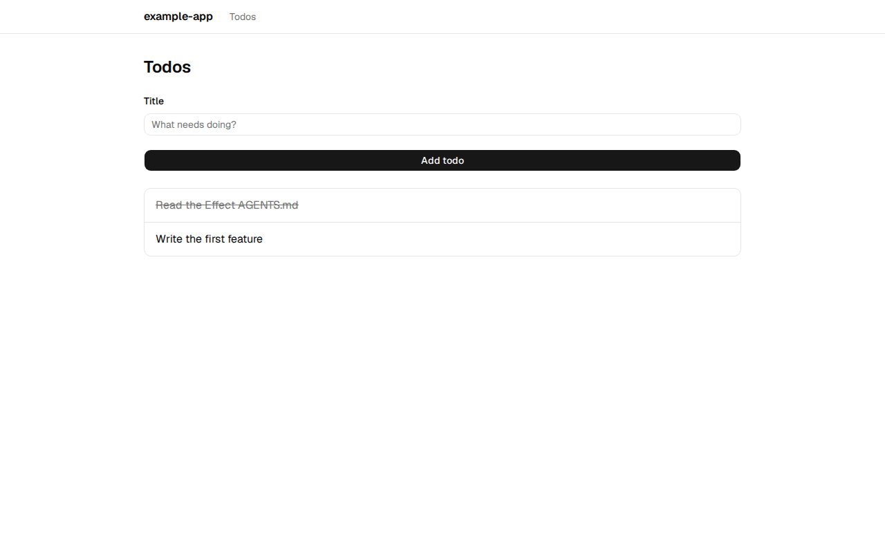
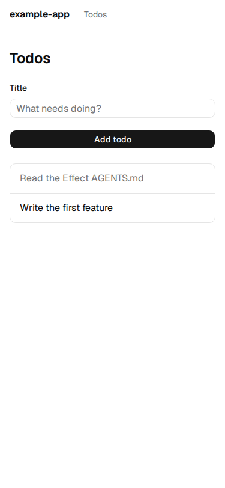
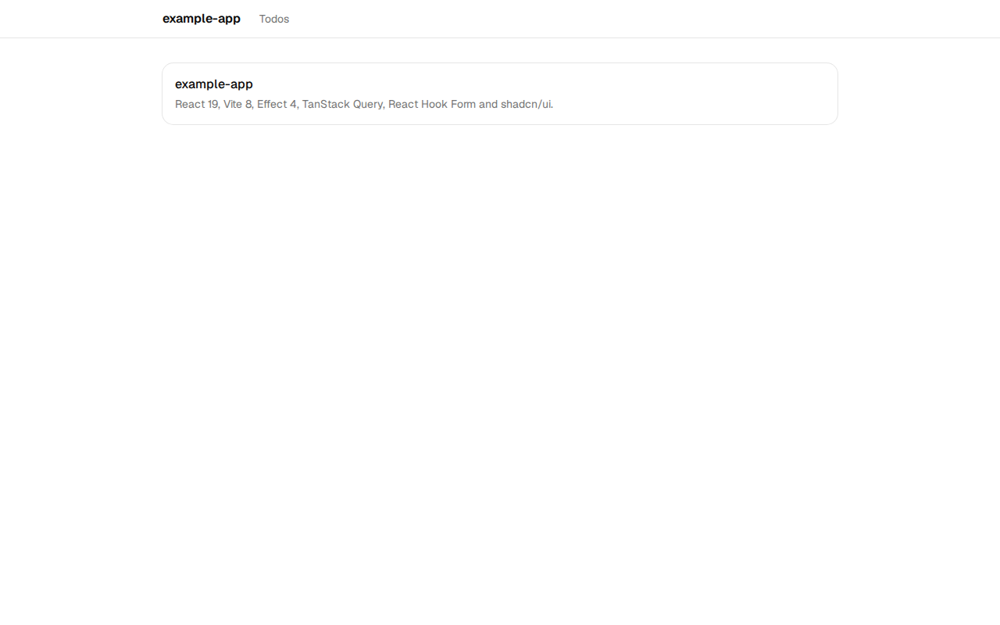
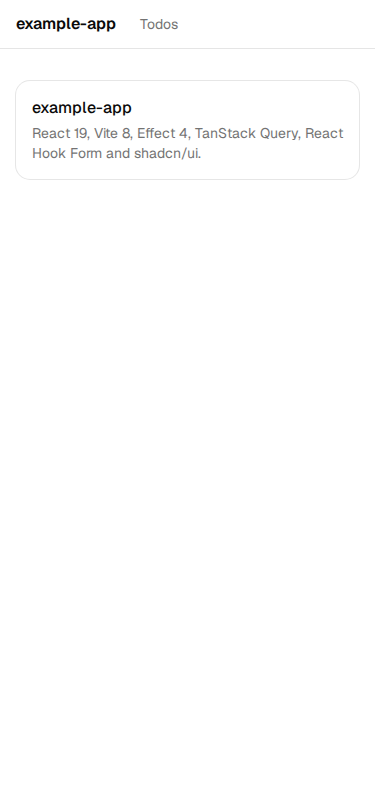
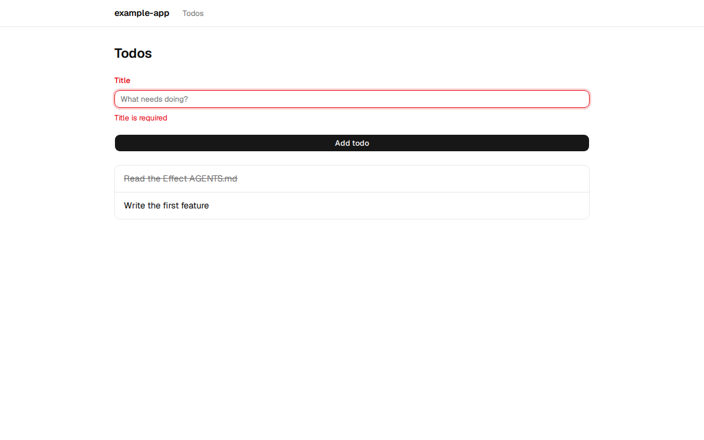
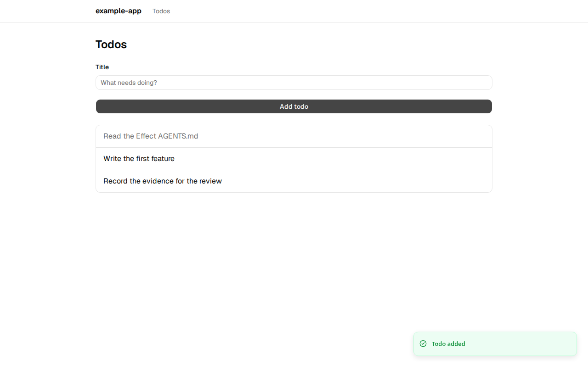
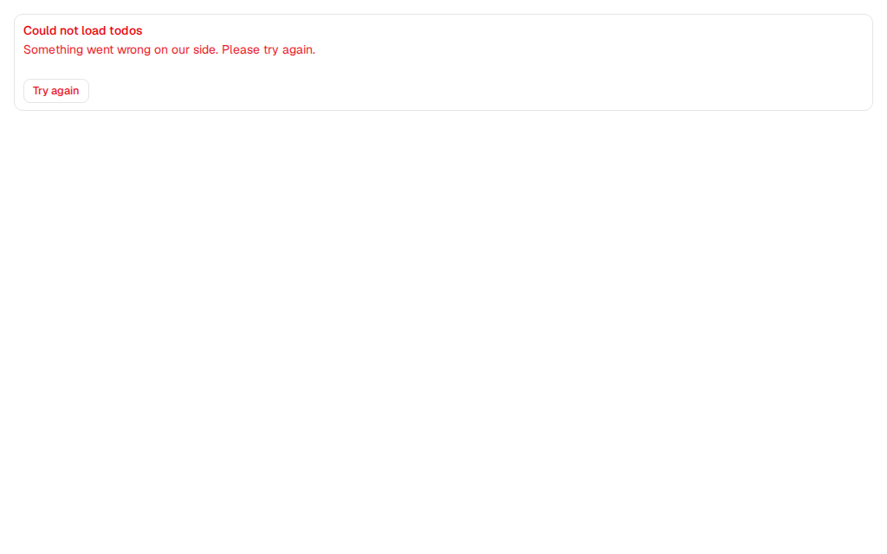
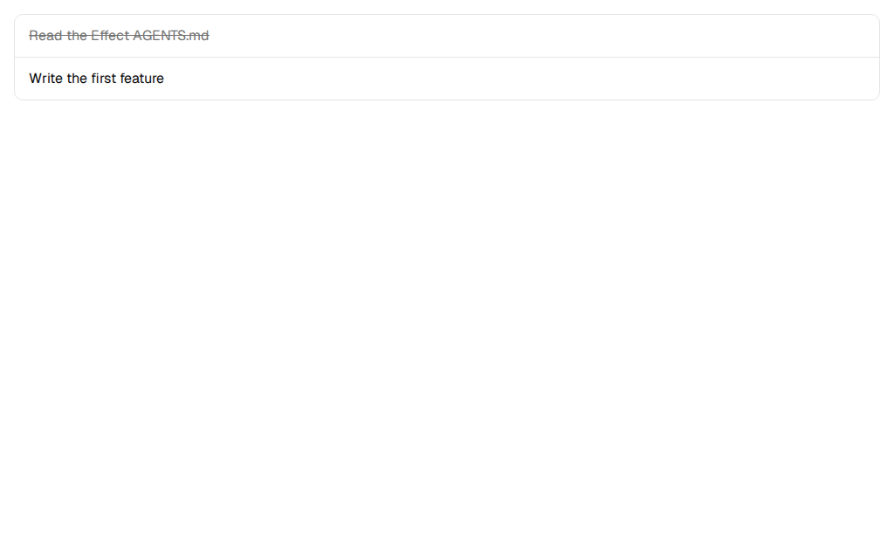
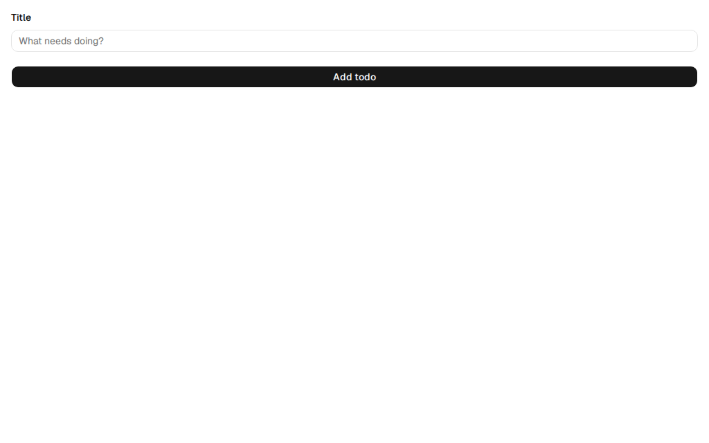
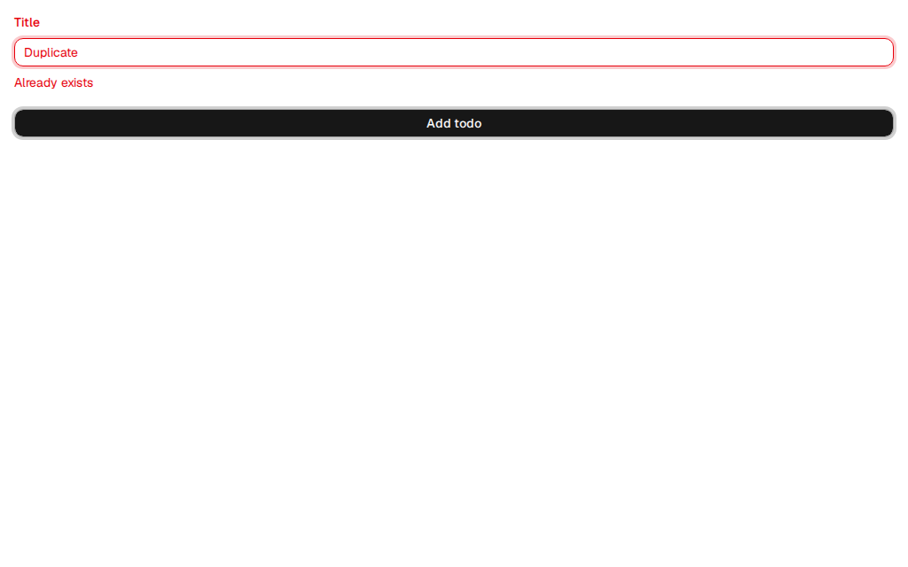

# Evidence

Recorded on 2026-10-20 on Linux with Node 22.22.3, pnpm 11.17.0 (from the template's
`packageManager`) and Chromium 156 driven by Playwright. Every file here was produced by running
the code. The logs differ from the terminal output in two ways only: terminal color codes are
stripped, and local paths are replaced by `<tmp>`.

| What | File | Result |
|---|---|---|
| CI job, run locally: fresh scaffold, all five gates | [`verify-sh.log`](verify-sh.log) | Lint, typecheck, 25 tests (88% lines), build, Storybook build: **pass** |
| Template + the todos feature quoted by `develop-feature`, all five gates | [`template-todos/pnpm-check.log`](template-todos/pnpm-check.log) | Lint, typecheck, 35 tests (95% lines), build, Storybook build: **pass** |
| The todos app in a browser, MSW serving the API | `template-todos/*.png`, [`todos-flow.webm`](template-todos/todos-flow.webm) | Screenshots and a recording below |
| Each component state in Storybook | `template-todos/storybook/*.png` | 7 stories |
| One-page summary of the delivery | [Summary artifact](https://claude.ai/artifact/WsEMWexLj3kYAuvJ8jrvxX) | Same evidence, with the open items |

The GitLab pipeline for this branch has not run: the project has no runner and shared runners
are off. `verify-sh.log` is the same script the CI job runs.

## The todos app

The worked feature that `develop-feature/references/` (and `api.ts`, `mocks.ts` in
`integrate-api/references/`) quote: a list and a create form at `/todos`, on a fresh scaffold,
started with `VITE_API_MOCKING=true pnpm dev`.

| Desktop (1280 px) | Mobile (375 px) |
|---|---|
|  |  |
|  |  |

### Create a todo (recording)

[`todos-flow.webm`](template-todos/todos-flow.webm): submit empty, see the validation message,
type a title, submit, see the new row and the "Todo added" toast.


| 1. Empty submit: client-side validation | 2. After submit: new row and toast |
|---|---|
|  |  |

### Every state, from Storybook

| Loading | Empty | Error with retry |
|---|---|---|
|  |  |  |

| Success | Form | Form with a 422 field error |
|---|---|---|
|  |  |  |

Whole page: [`todos-todospage--default.png`](template-todos/storybook/todos-todospage--default.png).

## Reproduce

From the repository root:

```bash
bash claude-skills/.claude/skills/code-skeleton/scripts/verify.sh

# the todos app: its source files were in claude-skills/evals/fixtures/todos/, removed after 5f11771
git archive 5f11771 claude-skills/evals/fixtures/todos | tar -x -C /tmp
bash claude-skills/.claude/skills/code-skeleton/scripts/scaffold.sh /tmp/todos-app todos-app
cp -r /tmp/claude-skills/evals/fixtures/todos/src/. /tmp/todos-app/src/
cd /tmp/todos-app && git init -q && git apply /tmp/claude-skills/evals/fixtures/todos/wiring.diff
pnpm install --frozen-lockfile && pnpm check
VITE_API_MOCKING=true pnpm dev   # then open /todos
```
