# web-dev: Claude Code plugin for web development

One request, tested code: `/web-dev:develop <request>` reads the folder and runs the skill that
fits, in a new folder or an existing React project. Three more skills write the contracts around
the code.

Stack: React 19, Vite 8, TypeScript 6, Effect 4, TanStack Query 5, React Hook Form 7, shadcn/ui on
Tailwind CSS 4, React Router 8, Vitest 5, MSW 3, Storybook 10, Playwright; GitHub Actions and
Cloudflare Pages for CI/CD.

<picture>
  <source media="(prefers-color-scheme: dark)" srcset="../docs/workflow-map/develop-dark.svg">
  
</picture>

## Install

Requirements, the marketplace command and the first run are in the
[repository README](../README.md#requirements); then
`claude plugin install web-dev@web-dev-plugin`. pnpm 10 or newer switches to the pinned pnpm
11.17 by itself.

- **Source:** the marketplace installs from `main`; append `#<ref>` to its URL for another branch
  or a release tag (`#web-dev--v<version>`). Git uses your own credentials and never prompts: an
  SSH key in `ssh-agent`, or a credential your git helper stores.
- **Updates:** a git install is a cached copy, so a release arrives only when `version` in
  `.claude-plugin/plugin.json` changes. Run `claude plugin update web-dev@web-dev-plugin` and
  restart Claude Code, or enable auto-update once (`/plugin` → Marketplaces → web-dev-plugin →
  Enable auto-update).
- **For a whole team:** run `marketplace add` in the repository with `--scope project` and commit
  the `.claude/settings.json` it writes; teammates who trust the folder get the marketplace.
- **Usage:** type `/web-dev:develop <request>`, or ask in plain words
  (`claude "Scaffold a new web app called billing-portal"` builds only the skeleton). Headless,
  one message runs to the end with no settings file:
  `claude -p "/web-dev:develop <request>" --permission-mode acceptEdits --allowedTools Skill`
  (see Permissions below).
- **Companion skills:** every new project gets eight third-party skills, fetched by
  `npx skills@1.7.2` at audited commits, without a question: see
  [Companion skills](#companion-skills) and [`docs/companion-audit.md`](docs/companion-audit.md).

<details>
<summary>From a clone, copied folders, or an existing project</summary>

**From a clone, to work on the plugin.** `git clone <repo-url> web-dev-plugin`, then
`claude plugin marketplace add ./web-dev-plugin` and the same install. A local marketplace is read
in place: edits load at the next session or after `/reload-plugins`, with no version bump.

**Or copy the folders.** Copy `skills/`, `references/`, `scripts/` and `agents/` into the project's
`.claude/` (or `~/.claude/` for every project), side by side: the skills reach the shared files as
`../../references/` and `../../scripts/`. `<plugin-dir>` is the `web-dev/` folder of your clone:

```bash
mkdir billing-portal && cd billing-portal && git init -b main
mkdir -p .claude
cp -r <plugin-dir>/{skills,references,scripts,agents} .claude/
claude "Scaffold a new web app called billing-portal"
```

`project-setup` asks for a landing page or a web app (with authentication), creates the project
from the boilerplate at the pinned commit, runs `pnpm install`, installs the companion skills and
runs `pnpm check:report`. From then on the generated root `CLAUDE.md` and `apps/web/CLAUDE.md`
hold the conventions; run the web-dev skills from `apps/web`. With copied folders, commit
`.claude/` and `skills-lock.json` so everyone gets the same skills.

**Existing project.** Ask through `/web-dev:develop`: it detects the project and, in one not made
from the boilerplate, maps the code first and builds on it. To add the companion skills to a
project on this stack, run from its root:

```bash
bash <plugin-dir>/skills/project-setup/scripts/install-companions.sh
```

The skills work only together: each reads the plugin's `references/`, `scripts/` or another
skill's references (its `compatibility` field says which), so one skill installed alone
(`npx skills add … --skill <name>`) has broken paths.

</details>

## Guardrails hook

Installing the plugin adds a PreToolUse hook (`hooks/hooks.json`): `node scripts/guard.mjs` runs
before every Bash, Read, Edit, MultiEdit, Write, NotebookEdit and Grep call Claude makes. It is on
whenever the plugin is enabled, in every folder, whether or not the project is a web-dev one, and
it needs `node` on your `PATH`.

| It refuses | Examples |
|---|---|
| History rewrites | `git commit --amend`, `git rebase`, `git reset --hard` |
| Discarding uncommitted work | `git clean -f`, `git checkout <path>`, `git restore <path>`, `git stash drop` |
| Overwriting or deleting on the remote | a force-push, deleting a remote branch |
| Skipping the git hooks | `--no-verify`, `HUSKY=0`, `core.hooksPath` |
| The release gate | a push to a protected branch, merging, approving or requesting changes on a pull request, a production deploy, a tag whose commit is not on the remote's default branch |
| Secret files | reading, editing or overwriting `.env*`, `.npmrc`, keys and certificates; creating a new one from `.env.example` is allowed |

The exact rules, and which are enforced by code, by a skill or only written down, are the table in
[`skills/guardrails/SKILL.md`](skills/guardrails/SKILL.md).

- **A refusal** reaches Claude as `Blocked by the web-dev guardrails: <reason>. See the guardrails
  skill.`, for example `git commit --amend rewrites a commit: make a new commit instead`. The
  `guardrails` skill tells Claude to say so and offer the safe alternative, not to try another
  route.
- **To go ahead anyway,** run the command yourself in your own terminal: the hook sees only Claude's
  tool calls.
- **To turn it off,** `claude plugin disable web-dev@web-dev-plugin` (back on with
  `claude plugin enable web-dev@web-dev-plugin`) or
  `claude plugin uninstall web-dev@web-dev-plugin`. That turns the skills off too: there is no
  switch for the hook alone or for one rule.
- It stops mistakes, not someone set on getting around it: an alias or a script file still gets
  through. The real lock on a protected branch is branch protection on the server.

## Skills

### Build

| Skill | Does | Example |
|---|---|---|
| `develop` | The entry point: detects the folder (`scripts/detect-project.mjs`), then builds a whole app (**A**, planned in `docs/plan.md`, asks only the git questions), changes a React project not made from the boilerplate (**B**, mapped first by the `codebase-explorer` agent, checked by `scripts/verify-project.sh`) or makes one change in an app from it (**C**) | "/web-dev:develop Build an employee management app with CRUD, search and forms" |
| `project-setup` | A new project from the react-vite-boilerplate (`scripts/create-project.sh`): a landing page or a web app with sign-in, companion skills installed, all gates green | "Scaffold a new web app called billing-portal, with login" |
| `feature-development` | A ticket → a feature folder: schemas, API calls, queries, form, the four UI states, routes, a test and a story per component | "Implement this ticket: &lt;paste or issue URL&gt;" |
| `api-integration` | One endpoint: schema, `ApiClient` call, query or mutation, MSW mocks, error tests | "Add PATCH /todos/:id to toggle completion" |
| `ui-development` | A design (screenshot, Figma frame, DESIGN.md) → matching UI with theme tokens and shadcn components, checked in a browser | "Make the settings page look like design/settings.png" |
| `deploy-setup` | The boilerplate's CI/CD (`scripts/sync-pipeline.mjs`) and Cloudflare Pages (app, Storybook, coverage and Allure report) with gh and wrangler, or Claude in Chrome without them; you paste the API token yourself | "Set up CI/CD and deploy this app to Cloudflare Pages" |

### Contracts

Each is checked by `scripts/check-contract.mjs`.

| Skill | Writes | Example |
|---|---|---|
| `ticket` | `docs/tickets/<id>/`: `intent.md`, `spec.md` (`AC-<n>` criteria, open questions), `plan.md` (`T<n>` tasks), committed on a branch; one subagent per ticket | "/web-dev:ticket 412 413 414" |
| `incident` | `docs/incidents/<id>/`: `report.md`, `rca.md` (each claim measured or hypothesis), `actions.md` (`A<n>`, which can become tickets) | "/web-dev:incident INC-12: login returned 500 after the 09:00 deploy" |
| `pr` | A draft PR (`gh`) or MR (`glab`) with the `pnpm check:report` checklist, ready only when CI passes; never pushes a protected branch, never merges | "/web-dev:pr" |
| `review-mr` | Reviews an MR or PR (security, correctness, these conventions, the linked ticket's ACs) and leaves its comments as a pending review only you see; you edit or delete them on the host, then say "post it" and it submits the rest as a comment review. Never approves or requests changes | "/web-dev:review-mr !12" · "post it" |

### Guardrails and releases

| Skill | Does | Example |
|---|---|---|
| `guardrails` | Before a push, a commit on a protected branch, a history rewrite, a merge, a deploy or reading a secret: lists which rules are blocked by code, checked by a skill or only written down, and asks instead of acting; its hook is described under [Guardrails hook](#guardrails-hook) | "/web-dev:guardrails" · "Push this to main" |
| `release` | A merged pull request → production: checks the PR's preview and CI, hands you the merge, follows the `main` run to `Deploy: production` and `E2E: production`, tags the merged commit when asked, rolls back through a revert PR. Never merges, approves, pushes `main` or deploys production itself; the hook enforces it | "Ship this to production" · "Roll back the last release" |

### Not covered

Out of scope: SSR / Next.js, non-React projects, backend code, CI/CD outside a project from the
boilerplate. Not yet: bug fixes, reviews without edits, commits beyond the contract commits;
`develop` says so and changes nothing.

## Troubleshooting

| You see | Why | Do |
|---|---|---|
| `project-setup` stops at its first step and names Node or pnpm | It needs Node 22.22 or newer (React Router 8's engines) and pnpm 10 or newer, and leaves system tools to you | Install or upgrade the tool, then ask again |
| `create-project.sh` ends with git's fetch error and no project | The boilerplate could not be fetched from github.com: no network, a proxy, or no access | Check that `git ls-remote https://github.com/loiphan-agilityio/react-vite-boilerplate.git` answers in your terminal. `BOILERPLATE_REPO=<URL or path>` fetches from a mirror or a local clone instead (its default branch unless `BOILERPLATE_REF` names a commit, branch or tag) |
| `error: these files already exist in <folder>; nothing was copied:` | The folder already holds files the project would overwrite; the script never overwrites | Use an empty folder, or move the listed files away |
| `Blocked by the web-dev guardrails: …` | The hook refused one of Claude's tool calls | Run the command yourself in your terminal: [Guardrails hook](#guardrails-hook) |
| A push to `main` is rejected | The project's `pre-push` hook refuses pushes to protected branches; on GitHub, a ruleset on `main` answers `GH013: Repository rule violations` | Work on a branch and open a pull request (`/web-dev:pr`). Only the scaffold commit goes straight to `main`, with `PROTECTED_BRANCHES=none git push -u origin main`; a ruleset is yours to lift, the skill prints the commands |
| The e2e gate fails for a missing browser | Playwright's Chromium is downloaded once per machine and needs network | `pnpm test:e2e:install` from the project root, then `pnpm check:report` |
| `companions not installed (<n>):` | The companion skills come from GitHub through npm's `skills` CLI and need network; the setup goes on without them | From the project root, run `install-companions.sh` again (the command is under [Install](#install), Existing project) |
| `develop` reports a monorepo root and stops | In a project from the boilerplate the skills run from the app | `cd apps/web && claude --add-dir ../..` |
| A new release does not arrive | A git install is a cached copy that changes only with `version` | `claude plugin update web-dev@web-dev-plugin`, then restart Claude Code |

## Contributing

1. Edit a skill in `skills/<name>/` (or the boilerplate first, then the skills that quote it).
   [`CLAUDE.md`](../CLAUDE.md) has the layout and every rule: hooks, the boilerplate pin, quoted
   snippets, shared references, releases, CI, companions.
2. Try it in a scratch folder: `claude --plugin-dir <clone>/web-dev`, then `/web-dev:develop …`.
3. From the repository root, run `pnpm lint`, `bash tools/verify.sh` and
   `bash tools/validate-skills.sh` (needs `pip install skills-ref==0.1.1 pyyaml==6.0.3` and
   skill-validator 1.8.0; see the script's header).
4. A routing change (a description, `develop`'s tables, `detect-project.mjs`) gets an eval case:
   write it, do not run it (`evals/README.md`, When evals run).
5. Open a pull request with a Conventional Commit message. CI runs `verify.sh`, the skills
   validator and the scripts' tests; the pre-commit hook lints staged scripts.

## What a new project gives you

<details>
<summary>ApiClient and typed errors, forms, MSW, tests, Storybook, config, auth, permissions, coverage, Oxlint rules</summary>

A project from the boilerplate passes lint, typecheck, tests, build, Storybook build and
Playwright e2e. Its app, `apps/web`, holds what every feature builds on (paths relative to it):

- **`ApiClient`** (`src/lib/api/client.ts`): the only way to call the backend. Effect 4
  `HttpClient`; decodes every body with an Effect Schema and maps every failure to a typed
  `ApiError` (`NetworkError`, `UnauthorizedError`, `ForbiddenError`, `NotFoundError`,
  `ValidationError`, `ServerError`, `InvalidResponseError`). Tested in `client.test.ts`.
- **`runEffect`** (`src/lib/api/run.ts`): runs an effect for TanStack Query with the abort signal
  and rejects with the typed error; components branch with `instanceof` or Effect's `Match`
  (never `_tag` by hand: anti-slop rejects it).
- **Forms:** React Hook Form + `effectTsResolver(schema)` (`@hookform/resolvers` 6, Effect 4) +
  shadcn `Field`; `setFormErrors` puts server field errors under their inputs.
- **MSW worker:** `postinstall` (`msw init`) writes `public/mockServiceWorker.js` from the
  installed msw, so it always matches. `pnpm dev:mock` (Vite mode `mock`, `.env.mock`) serves the
  API from the handlers in any shell, Windows included.
- **Tests:** MSW 3 in every test (unhandled requests fail); `renderRoute` / `renderWithProviders`
  mount the `Toaster` (with a `matchMedia` stub and a reset in `setup.ts`), so a toast is asserted
  as text.
- **Storybook 10** (`.storybook/`): stories render in `story-providers.tsx` (the providers a test
  uses) with MSW served by the app's worker; `pnpm build-storybook` is a gate.
- **Config:** `src/lib/config.ts` validates every `VITE_*` value with Effect Schema at startup;
  Effect code reads it as the `AppConfig` service, so a test can provide other values.
- **Auth:** `ApiClient` gets its bearer token from `AuthToken` (`src/lib/api/auth.ts`). Every web
  app provides `AuthToken.fromGetter(tokenStore.get, tokenStore.reject)` from `src/features/auth`
  in `src/lib/runtime.ts`, which drops the token on a 401; `AuthToken.none` is tested in
  `client.test.ts`.
- **Permissions:** each skill's `allowed-tools` approves the exact commands it runs (the plugin's
  scripts by their `${CLAUDE_SKILL_DIR}` path, and the pnpm gates) for its turn, even in an
  untrusted folder and with `-p`, so one message runs without a prompt; headless file edits need
  `--permission-mode acceptEdits`. For later turns, the project's `.claude/settings.json` allows the
  skills' pnpm commands, and its `PostToolUse` hook (`.claude/hooks/format.mjs`) runs Prettier on
  every file Claude writes. The root has one for sessions started there (Workflow A) and
  `apps/web/.claude/settings.json` one for sessions in the app, since Claude Code reads it only from
  the folder a session starts in. `create-project.sh` copies the root one only when the project has
  none, and it applies once the folder is trusted. `git init` and commits always prompt.
- **Coverage:** `pnpm test` fails below 80% lines in `src/features/**` and `src/lib/**`.
- **Oxlint guardrails** (`oxlint.config.ts`, the only linter): `no-restricted-imports` and
  `no-restricted-globals` reject common version mistakes (`react-router-dom`, `zod`, `axios`,
  `@effect/platform`, root `msw` helpers, `clsx`, `fetch` in any form, `XMLHttpRequest`);
  `pnpm lint` also runs `prettier --check`.
- **Oxlint code style:** arrow functions only (`func-style`, `prefer-arrow-callback`; `function*`
  stays for Effect), destructuring, shorthand, template literals, `??` / `?.` and
  typescript-eslint's stylistic type-checked rules (`--type-aware`), so later code reads like the
  template.

`feature-development/references/` (and `api-integration/references/` for `schemas.ts`, `api.ts`,
`queries.ts`, `mocks.ts`) quotes a full feature, todos with a list, a create form and a test file
per component, and the wiring diff for the two files a feature registers in.

</details>

## End-to-end tests and CI/CD (from the boilerplate)

<details>
<summary>Playwright, watch mode, the GitHub Actions pipeline and its Cloudflare variables</summary>

A project from the [react-vite-boilerplate](https://github.com/loiphan-agilityio/react-vite-boilerplate)
has them; `deploy-setup` brings an older project up to the pinned pipeline and connects Cloudflare
and GitHub (CI/CD in any other project is not yet covered).

- **End-to-end:** Playwright in `apps/web/e2e/`. `pnpm test:e2e` builds the app on mocks
  (`pnpm build:mock`) and serves it with `vite preview`, or tests `E2E_BASE_URL` when set. It is
  the sixth gate of `pnpm check`; `pnpm test:e2e:install` downloads Chromium once per machine.
  `feature-development` adds `e2e/<name>.spec.ts` for each feature's main flow, quoted from
  `references/testing.md` and run by `tools/verify.sh`.
- **Watch mode:** `pnpm test:watch` (`vitest --watch`) re-runs the affected tests on every save,
  even where `CI` is set.
- **CI/CD** (`.github/workflows/ci.yml`, `apps/web/public/_headers`): the checks (lint,
  typecheck, unit tests with coverage, build, Storybook, the mock build), a Cloudflare Pages
  preview of the app and Storybook (`pr-<n>` on a pull request), Lighthouse on it, then on `main`
  production and Playwright against the live URL with an Allure report. Each deploy adds a commit
  status (`Preview - Webapp Deployment`, `Prod - Webapp Deployment`) linking to it. It needs the
  `CLOUDFLARE_API_TOKEN` secret and the `CLOUDFLARE_ACCOUNT_ID` and `CLOUDFLARE_PAGES_APP_PROJECT`
  variables (more for Storybook and the reports): `deploy-setup` sets them, or see the
  boilerplate's `CLAUDE.md`.

</details>

## Pinned versions and why

<details>
<summary>TypeScript, Oxlint, Effect, React Router, MSW, Vitest, shadcn, Storybook</summary>

| Package | Version | Note |
|---|---|---|
| typescript | ~6.0 | The quoted code is verified on 6 (`verify.sh`), not 7.x yet. `baseUrl` is deprecated in 6; `paths` only. |
| oxlint | 1.89 | The only linter; `oxlint-tsgolint` 7.0.2004 runs the type-aware rules. No ESLint, so TanStack Query's ESLint rules do not run; `apps/web/CLAUDE.md` states the query-key rule in words. |
| effect | 4.0.5 | Forms use `effectTsResolver` from `@hookform/resolvers` 6, the first version for Effect 4. |
| react-router | 8.5 | No `react-router-dom`. Lazy route objects are mutated once loaded, so route trees are factories (`createRoutes()`). |
| msw | 3.0 | `http`/`HttpResponse` from `msw/http`, `delay` from `msw/utils/delay`, `onUnhandledFrame`. |
| vitest | 5.0 | `clearMocks` on by default; `vi.mock` top-level only. |
| shadcn | 4.22 | Style `radix-nova`; `cn` comes from shadcn's `cn` package. |
| storybook | 10.6 | `@storybook/react-vite` + addon-a11y. No `msw-storybook-addon` (3.0.3 calls MSW 2's `onUnhandledRequest`), so `.storybook/preview.tsx` starts the app's own worker. esbuild is allowed under `allowBuilds` (`esbuild: true`) in `pnpm-workspace.yaml`, since pnpm 11 blocks unreviewed install scripts. |

</details>

## Companion skills

<details>
<summary>Eight third-party skills, pinned to audited commits</summary>

Third-party skills for parts of the stack, installed by `install-companions.sh` (itself pinned to
`skills@1.7.2`) at an audited commit. The security and fit review of each is in
[`docs/companion-audit.md`](docs/companion-audit.md); what Claude must ignore in each is in
[`references/companions.md`](references/companions.md), which the skills that write app code read
first. When a companion disagrees with the project, the project's `CLAUDE.md` and the web-dev
skills win.

| Skill | Source | Commit | License | What it is for |
|---|---|---|---|---|
| `shadcn` | shadcn-ui/ui (official) | `d2fba50` | MIT | Adding and composing components, `Field` forms |
| `react-router-data-mode` | remix-run/agent-skills (official) | `33578aa` | MIT | Routing and navigation |
| `vite` | antfu/skills | `feb0f3a` | MIT | Vite 8 config and plugins |
| `vitest` | antfu/skills | `feb0f3a` | MIT | Vitest 5 API |
| `vercel-react-best-practices` | vercel-labs/agent-skills | `063bee9` | MIT | Client-side React performance |
| `vercel-composition-patterns` | vercel-labs/agent-skills | `063bee9` | MIT | Component API design, React 19 |
| `react-hook-form` | pproenca/dot-skills | `cf93c57` | MIT | Form performance |
| `react-testing` | affaan-m/ecc | `76aaa77` | MIT | RTL patterns |

No Effect companion: its guide ships in the package (`node_modules/effect/AGENTS.md`), and the
generated `CLAUDE.md` tells Claude to read it first. No TanStack Query companion: the most popular
one contradicted this stack, so `api-integration/references/react-query.md` is the source.

**Security note:** the official `shadcn` skill runs `npx shadcn@latest info --json` whenever it
loads (line 17 of its `SKILL.md`) and pre-approves `shadcn@latest` commands, which would run
whatever npm serves that day. `install-companions.sh` rewrites each one to `pnpm exec shadcn` (the
lockfile's CLI) and fails if any `shadcn@latest` is left. Since `skills-lock.json` keeps the
upstream hash, `npx skills check` reports that skill as modified; re-run the script after
updating it.

</details>
